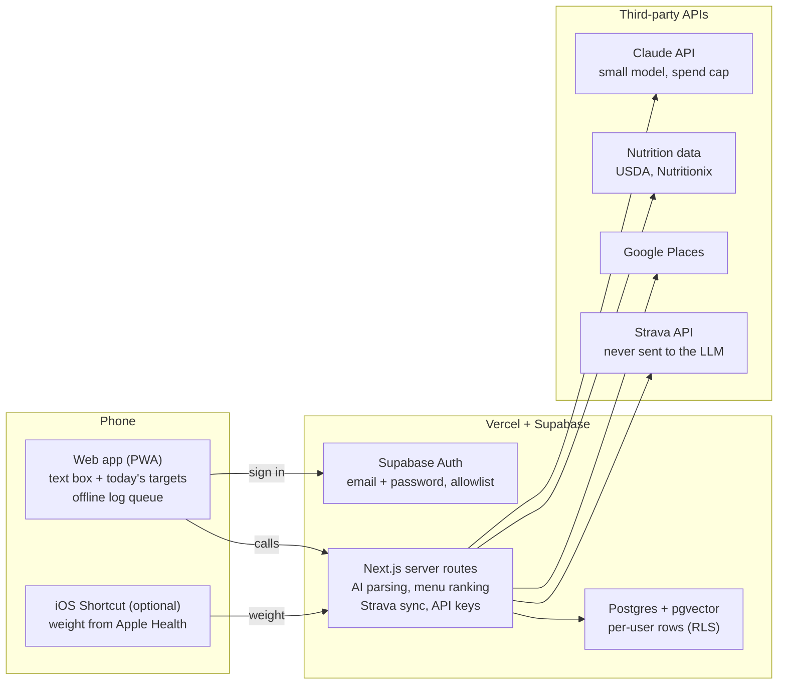

# Forkcast — Product Spec v1

As of Nov 24, 2026

## Overview

Forkcast is a personal web app, installed on my iPhone home screen. It turns one line of text into a logged meal, sets protein and calorie targets by the day's training, and suggests what to order before I eat out. V1 has one user, me, but every layer is built for many users so it doubles as an interview project.

**Goals**

- Log a new meal in under 10 seconds and a repeat meal in one tap.
- Targets that change with long runs, runs, Pilates and rest days.
- Top 3 orders at any restaurant, ranked by what is left of today's protein and calories.
- A weekly trend view instead of daily red numbers.
- Measure AI accuracy, so the numbers can be trusted and the project has a story.

**Non-goals for v1**

- A native iOS app or App Store listing (no Apple Developer account for now).
- Payments, social features or notifications.
- Meal plans, recipes or a full pantry barcode database.
- Medical advice or aggressive weight-loss targets.

**Decisions so far**

| Topic | Decision |
| --- | --- |
| Platform | Web app (PWA), added to the iPhone home screen |
| Workouts | Strava API; Strava data is never sent to the LLM |
| Weight | Entered by hand; optional iOS Shortcut from Apple Health |
| AI | Claude API on a small, fast model with a hard monthly spend limit |
| Building | AI-first with Claude Code |
| Repo and tasks | Public GitHub repo, GitHub Issues, GitHub Actions |
| Notifications | None |
| Testing | The AI eval set, plus checks in CI |
| Name | Forkcast for now; clear it before any public launch |

## Core flows

Seven flows make up v1. Logging and the repeat-meal cache come first because everything else depends on them.

1. **Home screen.** One screen: the text box at the top and today's remaining protein and calories below it. A polished public landing page for non-users comes later.
2. **Log a meal.** Type, or dictate with the keyboard mic, one line such as "salmon bowl, half the rice, iced latte".
   - Check the saved-meal cache first. On a hit, show the saved meal with no AI call.
   - On a miss, Claude splits the line into items, matches each to a nutrition-database entry and estimates portions.
   - Show an editable confirm card with items, macros and a confidence label. One tap saves it.
3. **Repeat meals.** Every confirmed meal becomes a reusable saved meal.
   - Nicknames: "my usual Sweetgreen" or "breakfast A" fill in instantly.
   - Similar-meal suggestions from text embeddings: "Same as your Harvest Bowl from Nov 12?"
   - Context suggestions before typing, by place, time of day and day of week.
   - Changes: "usual bowl, no rice" adjusts the saved meal instead of re-estimating it.
4. **What to order.** Pick a restaurant by search or from what's nearby.
   - Chains: use published nutrition data.
   - Independent spots: paste a menu link or take a photo; Claude reads it and estimates nutrition.
   - Return the top 3 orders for today's remaining targets, each with one swap, such as dressing on the side. Tapping one pre-fills the log.
5. **Day-type targets.** Pull activities from Strava, classify the day in plain code (rest, Pilates or strength, run, long run) and set that day's targets. A manual button covers unrecorded Pilates.
6. **Weigh-ins.** Entered by hand, or sent from Apple Health by an optional iOS Shortcut. The app only shows a smoothed trend.
7. **Weekly review.** Shown in the app each Monday, with no notification: average protein, intake against target, weight trend, cache hit rate and one suggestion for the week.

## Targets and safety guardrails

Targets start from an estimated baseline: maintenance calories, calculated from 2 to 3 weeks of logged intake and the weight trend. Each day type then adjusts it. Every number below is a default stored per user and editable in settings.

| Day type | Detected by | Protein (g) | Calories |
| --- | --- | --- | --- |
| Rest | No Strava activity that day | 100 | Baseline minus a small deficit (~250) |
| Pilates or strength | Pilates or strength activity in Strava, or the manual button | 110 | Baseline |
| Run | Strava run under the long-run distance | 110 | Baseline plus part of Strava's calorie estimate |
| Long run | Strava run at or over the long-run distance (default 8 mi) | 120 | No deficit; extra carbs |

**Guardrails (always on)**

- No daily calorie target below a configured floor.
- No deficit on long-run days.
- Target loss rate of about 0.5 lb a week at most. If the trend drops faster, raise the target.
- Flag under-fueling when average intake stays well below estimated expenditure for 2+ weeks.
- Wording: no red numbers, no "over budget", no streak guilt. The weekly trend is the headline, not the day.

## Data model

All tables live in Supabase Postgres. Every row carries `user_id`, and row-level security limits each user to their own rows.

| Table | Holds | Key fields |
| --- | --- | --- |
| profiles | Settings and target defaults | protein and calorie defaults, calorie floor, long-run distance, units, demo flag |
| saved_meals | Reusable meals (the cache) | name, nickname, items (JSON), macros, place_id, embedding (pgvector), use_count, last_used_at, version |
| meal_logs | Each time I ate something | logged_at, timezone, saved_meal_id, modifiers, portion (e.g. 0.5 for shared), macros, source (cache / AI / manual), confidence |
| foods | Nutrition entries already looked up | provider (USDA / Nutritionix / FatSecret), provider_id, per-serving macros |
| places | Restaurants I've ordered from | Google place_id, name, is_chain, last menu snapshot |
| strava_connections | Strava access | athlete id, encrypted refresh token, expiry, scopes |
| workouts | Activities pulled from Strava, plus manual Pilates | Strava activity id (dedup key), type, distance, duration, calorie estimate, source (Strava / manual) |
| day_targets | Each day's computed targets | date, day type, protein, calories, reason |
| weigh_ins | Weight entries | measured_at, weight, source (manual / Shortcut) |
| ai_calls | Every Claude call | purpose, model, tokens, cost, latency, cache hit or miss, error |
| eval_cases | Hand-checked meals for testing | input text, expected items and macros, notes |

## Tech stack and third-party services

The app is managed services on free tiers, stitched together by a few Next.js server routes. The only expected running cost is the Claude API, estimated at a few dollars a month for one user.

The phone never holds an API key. It signs in with Supabase, reads its own rows under row-level security and calls the server routes, which call Claude, nutrition data, Google Places and Strava. Strava data is only used by plain code, never in a prompt.

| Layer | Service | Why |
| --- | --- | --- |
| App | Next.js web app (PWA) on Vercel | Installs to the iPhone home screen; no App Store or $99 fee |
| UI | Tailwind + shadcn/ui | Clean defaults; Claude Code writes it well |
| Auth | Supabase Auth, email + password | Free; works inside a home-screen app; no email provider needed |
| Database | Supabase Postgres + pgvector | Per-user security and meal embeddings in one place |
| Server logic | Next.js server routes on Vercel | Keeps API keys off the phone; one deploy |
| AI | Claude API, small fast model | Cheapest per log; hard monthly spend limit |
| Nutrition data | USDA FoodData Central; Nutritionix or FatSecret | Free whole-food data; brands and chains |
| Restaurants | Google Places API | Finds the restaurant; menus come from links or photos |
| Workouts | Strava API | Where my runs already live |
| Weight | Manual entry; optional iOS Shortcut | The web can't read Apple Health |
| Errors and analytics | Sentry, PostHog | Free tiers |
| CI and hosting | GitHub Actions, Vercel previews | A live preview of every pull request |
| Building | Claude Code (Claude Pro plan) | Already paid for |

## Auth, access and distribution

The app supports many users but only lets me in. Opening it up later means removing one check.

- **Sign-in:** email and password through Supabase Auth, saved in iPhone Passwords and filled in with Face ID. Changed from a 6-digit email code (Nov 24, 2026): editing Supabase's email templates requires a custom SMTP provider, and one user who signs in once per device doesn't need email at all. Not a magic link: on iPhone a link opens Safari, not the home-screen app, which keeps its own storage. Sign in with Apple needs the paid developer account, so it's out for now. Password reset is done from the Supabase dashboard until email is set up.
- **Allowlist:** a Supabase auth hook rejects any email not on an `allowed_users` list.
- **Demo mode:** a separate demo account with seeded fake meals, workouts and weigh-ins, so interviews never show my real data.
- **Distribution:** a Vercel URL. On iPhone, Share → Add to Home Screen. Interviewers just open the link and use the demo login.
- **Strava:** OAuth connect; tokens stay server-side and encrypted; activity data is shown only to its owner.
- **Account deletion:** in-app delete that removes all of a user's rows and revokes Strava access.
- **Secrets:** Claude, nutrition, Places and Strava keys live only in Vercel environment variables. The repo is public, so CI runs gitleaks and all seed data is fake.
- **Limits:** per-user daily caps on AI calls, plus a hard monthly spend limit in the Anthropic Console.

## Edge cases

Most edge cases come from messy real-life logging, so the confirm card and one-tap edits are the main defense.

| Case | Handling |
| --- | --- |
| Shared or partial portion ("split fries") | Log with a portion factor; never overwrite the saved meal's normal portion |
| Vague amount ("some", "a bit") | Use a typical portion, mark it low confidence, offer quick size chips |
| Logged hours later or after midnight | Store local time and timezone; ask which day when it's after midnight |
| Edit to a saved meal | Ask: update going forward, or fix only this log |
| Restaurant changes its recipe | "Re-estimate" on any saved meal; versions keep old logs unchanged |
| Stale or rare suggestions | Rank by recency and frequency so old orders fade |
| Same activity synced twice | Dedupe by Strava activity id |
| Pilates not recorded | Manual "I did Pilates" button that sets the day type |
| Strava not connected or token expired | App still works with manual day types; show a reconnect prompt |
| No weigh-ins for a while | The trend just waits; no nagging |
| Daily weight swings (water, cycle) | Show only a smoothed trend, never the day-over-day change |
| iOS clears the app's local storage | The server is the source of truth; the local queue only holds unsynced logs |
| Claude returns bad or partial output | Validate against a schema, retry once, then fall back to manual entry |
| No signal on the subway | Queue logs locally and sync later |
| Menu photo unreadable | Ask for a link or a better photo; never guess dishes |

## AI quality: eval set and metrics

A fixed set of about 50 hand-checked meals tests every prompt or model change in CI. This is the project's strongest interview story.

- **Eval set:** meals with known nutrition. Use chain items with published data, plus home meals I weigh. Cover the hard cases: mixed bowls, shared plates, drinks, vague amounts.
- **Growing it:** any confirm card I edit heavily becomes a candidate eval case.
- **Grounding:** Claude picks foods from database search results and estimates portions. It doesn't make up nutrition numbers.
- **Cost:** CI runs the eval set only when prompt or model files change, to keep API spend low.
- **Other tests:** the eval set is the main test suite. CI also runs typecheck, lint and gitleaks; no end-to-end tests in v1.

| Metric | What it shows |
| --- | --- |
| Calorie error (mean absolute %) | How far estimates are off |
| Protein error (mean absolute %) | Accuracy on my main target |
| Parse success rate | Share of lines turned into valid items |
| Cache hit rate | Share of logs served without an AI call |
| Edit rate | Share of confirm cards I change before saving |
| p50 and p95 latency | Time from typing to confirm card |
| Cost per log | AI and API spend per logged meal |

## V1 scope, milestones and open questions

V1 is done when I've logged every meal for 2 straight weeks without wanting to quit, and the eval set runs in CI.

**Milestones, in order**

1. **Foundation:** GitHub repo with CLAUDE.md, Next.js PWA on Vercel, Supabase project, email + password sign-in with the allowlist, per-user tables, CI with gitleaks, Sentry.
2. **Logging:** home screen with the text box and today's targets, confirm card, nutrition-database grounding, offline queue. Write the first 20 eval cases before the prompt.
3. **Cache:** saved meals, nicknames, similar-meal suggestions, changes to saved meals.
4. **Targets:** Strava connect and sync, day types, manual Pilates button, guardrails, manual weigh-ins with a smoothed trend.
5. **Eval and polish:** 50-case eval set in CI, ai_calls cost view, demo account, README and architecture diagram.
6. **What to order:** restaurant search, chain data, menu photo or link, top 3 with swaps.
7. **Weekly review:** in-app Monday summary.
8. **Later:** optional weight Shortcut, then a public landing page for non-users.

**Open questions**

- [ ] Which nutrition API covers NYC chains best: Nutritionix or FatSecret, and at what price?
- [ ] Which small Claude model gives good enough accuracy on the eval set?
- [ ] What monthly spend limit to set in the Anthropic Console?
- [ ] What long-run distance and calorie floor should the defaults use?
- [ ] Should context suggestions use location, or is time of day enough for v1?
- [ ] Before any public launch, get a lawyer's trademark clearance for "Forkcast": a pending US application for FORKCAST covers restaurant software, and several food apps already use the name.

## Build workflow

Claude Code writes most of the code from this spec; I review and merge every change.

1. **Set up the repo:** public GitHub repo with this spec as `docs/spec.md` and a `CLAUDE.md` holding the stack, conventions, commands and hard rules (no keys in code, no Strava data in prompts, all data per user).
2. **Turn milestones into issues:** one GitHub Issue per small task, each with acceptance criteria. Claude Code reads and updates them with the `gh` CLI.
3. **One issue per loop:** branch, Claude Code implements it, open a pull request.
4. **Check it:** CI runs typecheck, lint, gitleaks, and the eval set when prompts change. Vercel posts a preview link to open on my phone.
5. **Merge and deploy:** merging to main deploys to production on Vercel.

GitHub is the fastest option with Claude Code: it works natively with git and `gh`, and Actions plus Vercel previews are free.
